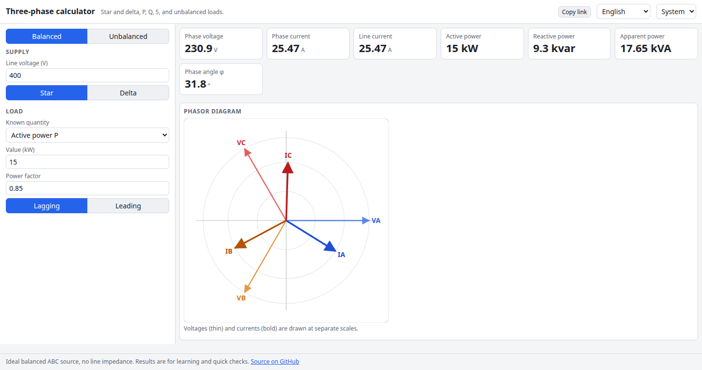

# Three-Phase Power Calculator

Work out three-phase circuits: enter the line voltage and either a current, a power or a load, pick star or delta, and get the line and phase voltages and currents, active, reactive and apparent power and the power factor. Switch to unbalanced loads to see the neutral current, the neutral shift and a phasor diagram of every voltage and current.

**Try it: [hermes98761234.github.io/three-phase-calculator](https://hermes98761234.github.io/three-phase-calculator/)**

[](https://github.com/hermes98761234/three-phase-calculator/actions/workflows/deploy.yml)



## Features

- **Star and delta**, line and phase quantities, with the sqrt(3) relations handled for you.
- **Balanced mode** from line current, active power or apparent power plus power factor (lagging or leading): P, Q, S, phi.
- **Unbalanced mode** for three independent R + jX loads on a 4-wire star, a 3-wire star (floating neutral) or a delta.
- **Phasor diagram** of the phase voltages and currents, including the neutral current.
- **Per-phase table** with magnitude and angle of voltage, current and power, totals and an imbalance figure; CSV export.
- **English or Ukrainian, light or dark**; inputs are remembered and can be shared as a link.

## How it works

Balanced: S = sqrt(3) V_L I_L, P = S cos(phi), Q = S sin(phi). Star has V_ph = V_L / sqrt(3) and I_ph = I_L; delta has V_ph = V_L and I_ph = I_L / sqrt(3). Unbalanced: the source is a balanced ABC sequence with Van at 0 degrees. A 4-wire star gives I_k = V_k / Z_k and I_N = -(I_a + I_b + I_c). A 3-wire star finds the neutral shift with Millman's theorem, V_nN = sum(V_k Y_k) / sum(Y_k). A delta gives I_ab = V_ab / Z_ab and line currents I_a = I_ab - I_ca. Complex arithmetic is in src/lib/three.ts and is covered by unit tests.

## Quick start

You need [Node.js](https://nodejs.org/) 22.

```bash
git clone https://github.com/hermes98761234/three-phase-calculator.git
cd three-phase-calculator
npm install
npm run dev       # http://localhost:5173
npm test          # unit tests for the calculation library
npm run build     # static site in dist/
```

## License

MIT
